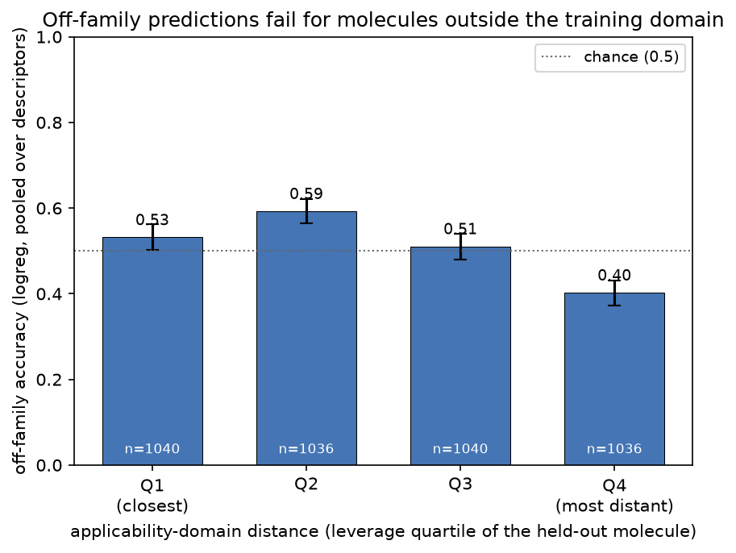

# gelation-transfer

**A cross-chemistry benchmark for low-molecular-weight gelator (LMWG) prediction.**

> ## Headline finding
> Machine-learning gelation predictors that score AUC **0.79–0.97 within** a
> chemical family fall to **≈ 0.5 (chance), and sometimes below,** on a family
> they were never trained on. What survives the chemistry gap is a *trust flag*:
> off-family predictions are reliable only for molecules inside the training set's
> applicability domain — **accuracy 0.56 inside the Williams leverage domain vs
> 0.46 outside, and 0.40 for the most distant quartile.** Descriptor-space
> leverage and nearest-neighbour distance flag the failures (p ≈ 10⁻¹⁰);
> ECFP4 structural novelty does not. A commercial descriptor package (alvaDesc)
> transfers no better than open-source descriptors.



## What this is

Most published gelation predictors are trained and tested inside one chemical
family. This benchmark measures how far such a model generalises to a family it
never saw, and whether the off-family accuracy drop is explained by a published
applicability-domain (AD) distance. Standard methods only — scikit-learn, RDKit,
nested cross-validation — with leak-freedom made structural. The contribution is
an honest, reproducible benchmark, not a new algorithm. Full write-up:
[`report/REPORT.md`](report/REPORT.md).

**Families (1038 molecules):** nucleosides (71, experimental), tripeptides (600,
coarse-grained-MD aggregation propensity thresholded at AP ≥ 1.5), experimental
self-assembling peptides (367). Provenance and licences: [`PROVENANCE.md`](PROVENANCE.md).

## Results at a glance

| | within-family AUC | cross-family AUC |
|---|---|---|
| nucleoside | 0.79 | 0.34–0.54 |
| peptide_expt | 0.91 | 0.40–0.65 |
| tripeptide | 0.97 | 0.45–0.66 |

RQ1 — transfer collapses to chance across **every** descriptor (RDKit-2D, Morgan,
Mordred) and model (logistic regression, random forest, HistGradientBoosting).
RQ2 — the drop is explained at the molecule level by AD **leverage/kNN distance**,
not by fingerprint novelty. RQ3 — no descriptor robustly transfers better; the
commercial **alvaDesc** (4215 2D descriptors) lands in the same near-chance band
(0.50–0.58) as the open sets, and the intervals overlap.

## Reproduce

```bash
python -m venv .venv
. .venv/Scripts/activate      # Windows;  source .venv/bin/activate on Unix
pip install -r requirements.txt
python run_all.py             # full pipeline, or: python run_all.py --from 3
pytest                        # data invariants, leakage guard, domain math, determinism
```

Raw downloads land in `data/raw/` (git-ignored; the manifest with sha256 hashes is
tracked); everything downstream — `data/processed/gelation_all.csv`, results
tables, and figures — is tracked and regenerable. To add the commercial
descriptor arm, run alvaDesc on the exported `.smi` files following
[`data/features/alvadesc_inputs/ALVADESC_INSTRUCTIONS.md`](data/features/alvadesc_inputs/ALVADESC_INSTRUCTIONS.md)
and drop the CSVs into `data/features/`; the pipeline picks them up automatically.

## Layout

```
src/gelbench/     data · features · evaluate · domain · transfer · plots
experiments/      01_curate → 06_figures        (run by run_all.py)
data/processed/   gelation_all.csv  (id, smiles, label, family, source_doi)
results/ tables/ figures/            regenerable outputs
tests/            pytest suite incl. the leakage guard
report/REPORT.md  full write-up
```
